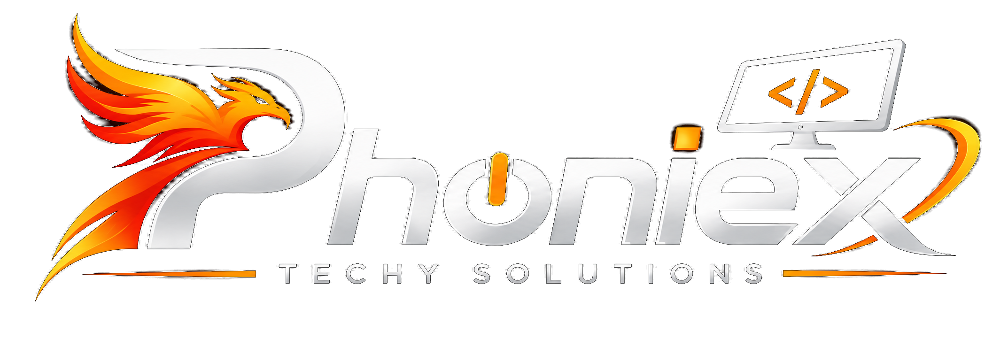

# 🔥 Phoniex Technologies - Next-Generation Digital Ecosystem

A cutting-edge, high-performance web platform built with **React 19**, **TypeScript**, and **Vite**, featuring the flagship **Inferno Core** fire design system, interactive 3D particle physics, and an enterprise **HRMS Platform Suite**.



---

## 🌟 Key Features

### 1. 🔥 Flagship Fire Design System
* **Three Curated Fire Themes:**
  * **Inferno Core:** Dark obsidian with molten ember accents (Flagship).
  * **Solar Flare:** High-energy magma with bright solar bursts.
  * **Molten Ember:** Deep volcanic crimson with gold sparks.
* **Glassmorphism & Depth:** Custom glass panels with backdrop blurs, fiery glow rings, and border highlights.
* **Interactive 3D Canvas:** Live particle canvas simulating floating embers and quantum nodes with cursor interactivity.
* **3D Tilt Cards:** Holographic sheen cards that react to mouse position with perspective transforms.

### 2. ⚡ Enterprise HRMS Platform Suite
* **Interactive 3D Clock Tracker:** Real-time analog clock hands with dynamic sessions, check-in/out toggling, and live session timers.
* **Smart Leave Planner:**
  * Executive overview stat bar (Available Days, Utilized Days, Pending Review).
  * Leave classification selector (Annual, Medical, Casual).
  * Native dark-mode responsive date pickers with zero mobile clipping.
  * Recent leave history records with status badges (`APPROVED`, `PENDING`, `REJECTED`).
* **KPI Metrics & Progress Rings:** Dynamic SVG circular progress gauges displaying attendance, KPI rating scores, and leave quotas.
* **Performance Hub:** SVG interactive performance analytics trend chart and operational audit logs.

### 3. 📱 Responsive Architecture
* Engineered to render on all viewport widths down to **320px**.
* Mobile-optimized 2×2 sub-navigation grids and responsive stacked forms.
* Deep linking and browser history support via URL hash navigation (`#home`, `#about`, `#services`, `#portfolio`, `#contact`, `#hrms`).

### 4. 📬 Encrypted Secure Contact Stream
* Contact form wired with asynchronous email transmission endpoint (`phoniexsaim@gmail.com`).
* Interactive paper-airplane launch animations with fallback to direct client protocols.

---

## 🛠️ Tech Stack

* **Framework:** React 19
* **Language:** TypeScript
* **Bundler & Tooling:** Vite, ESBuild, PostCSS
* **Icons:** Lucide React
* **Styling:** Custom Vanilla CSS variables, Glassmorphism, 3D Canvas
* **Font Typography:** Outfit (Headings), Inter (Body)

---

## 🚀 Getting Started

### Prerequisites
* [Node.js](https://nodejs.org/) (v18 or higher recommended)
* [npm](https://www.npmjs.com/)

### Installation
```bash
# Clone the repository
git clone https://github.com/phoniexsaim/New-Website.git

# Navigate into the project folder
cd New-Website

# Install dependencies
npm install
```

### Running Locally
```bash
npm run dev
```
Open [http://localhost:5173](http://localhost:5173) in your browser.

### Building for Production
```bash
npm run build
```
The compiled output will be generated in the `dist/` directory.

---

## 📄 License
© 2026 Phoniex Technologies. All rights reserved.
